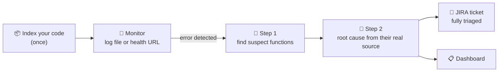

# 🔍 Debug Pipeline

**Automated backend error triage.** Debug Pipeline watches your logs, uses an LLM to trace each error back to the functions in your codebase that most likely caused it, and files a JIRA ticket with the root cause, debugging steps and fixes already written, so nobody has to triage it by hand.


## How it works



1. **Index.** Your backend source is parsed into a function-level index (name, docstring, source, API routes). Python, JavaScript/TypeScript, Java and Go are supported.
2. **Monitor.** A JSON log file is tailed for `ERROR` / `CRITICAL` / `FATAL` lines, or a health-check URL is polled and raises an event after repeated failures.
3. **Analyze in two LLM steps** (Groq, `openai/gpt-oss-120b`):
   - **Identify:** the error plus the function *index* goes to the LLM, which names the most likely culprits.
   - **Analyze:** the *actual source* of those functions goes back for a full diagnosis covering root cause, technical explanation, debugging steps, fixes, severity, confidence and affected components.
4. **Report.** A JIRA ticket is created with the whole analysis in its description, plus a plain-text backup comment.
5. **Fix (on demand).** From an incident, **Auto-fix** asks the LLM to rewrite the suspected functions and shows the result as a diff. You can download it as a `.patch`, or apply it to the indexed folder and revert it later.

## Dashboard

The Streamlit dashboard (`frontend/streamlit_app.py`) talks to the FastAPI backend over HTTP.

| Page | What it's for |
|---|---|
| 🏠 **Overview** | Pipeline status (index → monitor → AI → JIRA), incident KPIs, severity breakdown, latest incidents |
| 📡 **Live Monitor** | Start/stop log or health-check monitoring; live incident feed that refreshes every 4 s |
| 📋 **Incidents** | Filter by severity, search, then open any incident to see its fixes, an auto-generated code patch, debugging steps, explanation, suspected functions and raw log; links straight to its JIRA ticket |
| 📦 **Codebase** | Build the index from a ZIP upload or a folder; searchable browser of every indexed function |
| 🧪 **Test Logs** | Generate realistic fake logs with injected errors to try the pipeline end to end |
| ⚙️ **Settings** | Check the API, Groq key and JIRA connection (lists your project's issue types and priorities) |


## Run the whole project

### 1. Requirements

- **Python 3.10+** (check with `python --version`)
- A free **Groq API key**: [console.groq.com/keys](https://console.groq.com/keys)
- *Optional:* a free **JIRA Cloud** site, if you want tickets: [atlassian.com/software/jira/free](https://www.atlassian.com/software/jira/free)

### 2. Install (once)

```bash
git clone https://github.com/Nishikant090/debug-pipeline.git
cd debug-pipeline
python -m venv venv
venv\Scripts\activate          # Windows  (macOS/Linux: source venv/bin/activate)
pip install -r requirements.txt
copy .env.example .env         # macOS/Linux: cp .env.example .env
```

### 3. Configure

Open `.env` and set at least:

```ini
GROQ_API_KEY=gsk_your_key_here
```

To get JIRA tickets, also fill in `JIRA_BASE_URL`, `JIRA_EMAIL`, `JIRA_API_TOKEN` and `JIRA_PROJECT_KEY` (see [Configuration](#configuration)). Without them, everything still works, but no tickets are created.

### 4. Start the two processes

The project is two programs: the **API** (does the indexing, monitoring and AI work) and the **dashboard** (the web UI). Run each in its own terminal, with the virtual environment activated in both:

```bash
# Terminal 1 — backend API
uvicorn app.main:app --port 8088
```

```bash
# Terminal 2 — dashboard
streamlit run frontend/streamlit_app.py
```

Open **http://localhost:8501** for the dashboard. The API's interactive docs are at http://127.0.0.1:8088/docs. Keep both terminals open while you use it. To stop, press `Ctrl+C` in each.

### 5. Check it works

On **⚙️ Settings**, *Backend API* should be **Online** and *Groq API key* should say **Looks valid**. If you set up JIRA, click **🔌 Test JIRA connection**.

### 6. Run the tests (optional)

```bash
pip install pytest
pytest
```

## Demo walkthrough

The repo ships with a matching demo pair, so you can show the whole system without a real production app:

- [`sample_backend/`](sample_backend/): **ShopFlow**, a small e-commerce backend with **6 deliberate bugs**.
- [`sample_logs/shopflow.log`](sample_logs/shopflow.log): 24 log lines from ShopFlow, **6 of them errors**, each caused by one of those bugs.

### What to paste where

| Page | Field | Paste this |
|---|---|---|
| 📦 **Codebase** → *Folder on the API server* | Absolute folder path | The full path to `sample_backend` in your clone, e.g. `C:/Users/you/debug-pipeline/sample_backend` |
| 📡 **Live Monitor** → *Log file* | JSON log file | `sample_logs/shopflow.log` |
| 📡 **Live Monitor** → *Health-check URL* | URL to poll | `http://127.0.0.1:9999/health` (nothing runs there, so it fails on purpose) |
| 🧪 **Test Logs** | Output file | `test_logs/live.log` (the default) |

> **Tip:** to get the absolute path, right-click the `sample_backend` folder in VS Code → **Copy Path**. Forward or back slashes both work.

### Step by step

1. **Index the code.** **📦 Codebase** → *Folder on the API server* → paste the `sample_backend` path → **Build index from folder**. Expected: *23 files, 45 functions*. Search `dispatch` in the function browser to show what the AI will see.
2. **Start monitoring.** **📡 Live Monitor** → *Log file* → paste `sample_logs/shopflow.log` → **▶ Start monitor**. The monitor reads the whole file first, so *Errors detected* jumps to **6**. The AI then analyses them one at a time (about 10–30 s each), and *Analysed* and *JIRA tickets* count up.
3. **Show the overview.** **🏠 Overview**: pipeline status, severity breakdown, top services, latest incidents.
4. **Open an incident.** **📋 Incidents** → tick a row. Walk through the tabs: *Fixes*, *Debugging steps*, *Explanation*, *Suspected functions* (shows which function Step 1 picked and why) and *Raw log*. Click the JIRA key to open the ticket.
5. **Auto-fix.** In the same incident, open **🩹 Auto-fix** → **Generate fix** → review the diff → **Apply to files** (the file in `sample_backend/` really changes) → **↩ Revert** (the bug comes back).
6. **Live stream.** **🧪 Test Logs** → **▶ Generate** → **Monitor it**. New errors are written, detected and analysed live.
7. **Health checks.** **📡 Live Monitor** → *Health-check URL* → paste `http://127.0.0.1:9999/health`, *Check every* `3`, *Failures before alert* `3` → **Start monitor**. After about 9 s, an incident says the service is down. Click **⏹ Stop** when done.

### The 6 demo bugs

Use this table to check the AI's answers. *Suspected functions* should name the function in the last column.

| Severity in log | Service | Error | Bug lives in |
|---|---|---|---|
| ERROR | auth-service | Authentication failed — invalid credentials | `login_user` · `auth/auth_service.py` |
| ERROR | api-gateway | `NoneType` object has no attribute `user_id` | `dispatch` · `api/middleware.py` |
| ERROR | payment-service | Card number fails Luhn check | `validate_card` · `payments/validator.py` |
| ERROR | db-service | Query exceeded 30 s limit | `run_query` · `database/executor.py` |
| CRITICAL | db-service | Connection pool exhausted | `acquire` · `database/pool.py` |
| ERROR | cache-service | Failed to unpickle cached object | `deserialize` · `cache/serializer.py` |

### Before you present again

- **Revert every applied fix** (or run `git checkout sample_backend`), otherwise the demo bugs are gone. `git status` should show no changes in `sample_backend/`.
- **Incidents → Clear events** to start from an empty dashboard. Restarting the API also clears them.
- Each run creates new JIRA tickets. Close the old ones in JIRA to keep the board tidy.

> **Why the index matters:** Step 1 can only point at real functions if you index the code that *produced* the logs. With an unrelated index, the analysis falls back to reasoning from the log text alone, and the *Suspected functions* tab says so.

## Configuration

All settings live in `.env` (template: [`.env.example`](.env.example)). Restart the API after changing them.

| Variable | Required | Where to get it |
|---|---|---|
| `GROQ_API_KEY` | ✅ | [console.groq.com/keys](https://console.groq.com/keys) |
| `JIRA_BASE_URL` | for tickets | Your site, e.g. `https://yourname.atlassian.net` (from the browser address bar, without `/jira/...`) |
| `JIRA_EMAIL` | for tickets | The email you log in to Atlassian with |
| `JIRA_API_TOKEN` | for tickets | [id.atlassian.com → API tokens](https://id.atlassian.com/manage-profile/security/api-tokens) |
| `JIRA_PROJECT_KEY` | for tickets | Ticket prefix, e.g. `KAN` for `KAN-1` (also in the board URL after `/projects/`) |
| `SMTP_USERNAME`, `SMTP_APP_PASSWORD`, `NOTIFY_EMAIL` | optional | Gmail + [App Password](https://myaccount.google.com/apppasswords); used by `demo_app.py` to email you when a ticket is created |
| `ALLOW_FIX_APPLY` | optional | `true` by default. Set `false` to stop the dashboard writing patches to disk (patches can still be downloaded) |
| `FIX_APPLY_ROOT` | optional | Only let **Apply** write inside this folder, e.g. `sample_backend` |
| `DEBUG_PIPELINE_API` | optional | Dashboard → API address if the API isn't on `http://127.0.0.1:8088` |

Use **Settings → Test JIRA connection** to verify the credentials. Tickets are created as `Bug`, falling back to `Task` if the project has no `Bug` type. If JIRA rejects a field, the client retries with fewer fields instead of failing.

## Deploy on Render

The repo includes a [`render.yaml`](render.yaml) Blueprint. It runs one free web service that starts the API privately on `127.0.0.1:8088` and serves the dashboard on the public URL ([`render_start.sh`](render_start.sh)).

1. On [Render](https://dashboard.render.com), choose **New → Blueprint** and connect this GitHub repo.
2. Fill in the secrets Render asks for: `GROQ_API_KEY`, plus the four `JIRA_*` values to create tickets.
3. Click **Apply**. The first build takes a few minutes.

On the free plan, the service sleeps after 15 minutes without traffic, and the next visit takes about a minute to wake it. The disk is reset on every restart, so incidents are cleared and `sample_backend/` is re-indexed automatically. If the URL is public, anyone can use the dashboard, which spends your Groq quota and creates tickets in your JIRA project. The Blueprint sets `FIX_APPLY_ROOT=sample_backend`, so **Apply to files** can only change the demo backend, never the app itself. Set `ALLOW_FIX_APPLY=false` to turn Apply off completely; downloading patches still works.

## Standalone demo (no backend)

[`demo_app.py`](demo_app.py) is a self-contained Streamlit app that calls the indexer and analyzer in-process. It needs no FastAPI server, so it can be deployed as-is on Streamlit Community Cloud. One click indexes this repo's `app/` folder, and you then pick a sample error (or paste your own JSON log line) to run the real pipeline.

```bash
streamlit run demo_app.py
```

Visitors can enter **their own** JIRA credentials in the sidebar (kept for the session only, never stored) to turn an analysis into a ticket in their own project. When deploying on Streamlit Cloud, add `GROQ_API_KEY` (and optionally the SMTP variables) under the app's **Secrets**.

## Log format

One JSON object per line. `level` and `message` (or `msg`) are used; every other field is passed to the LLM as context:

```json
{"timestamp": "2026-05-19T10:02:33Z", "level": "ERROR", "message": "AttributeError: 'NoneType' object has no attribute 'email'", "service": "auth-service", "traceback": "File \"app/services/auth_service.py\", line 42, in login_user ..."}
```

Generate test logs from the terminal:

```bash
python log_generator/fake_log_generator.py --output test_logs/live.log --count 200 --error-rate 0.2   # batch
python log_generator/fake_log_generator.py --output test_logs/live.log --interval 1.0                  # live stream
```

## API reference

Interactive docs: `http://127.0.0.1:8088/docs`

| Endpoint | Description |
|---|---|
| `POST /api/v1/index/upload` | Upload a ZIP of your backend and build the index |
| `POST /api/v1/index/path?directory=…` | Index a folder on the API server |
| `GET /api/v1/index/status` | Current index status |
| `POST /api/v1/monitor/start` | Start watching a log file (`{"log_path": …}`) or a URL (`{"monitor_type": "health", "health_url": …}`) |
| `POST /api/v1/monitor/stop` | Stop the active monitor |
| `GET /api/v1/monitor/status` | Monitor status and counters |
| `GET /api/v1/monitor/debug` | Detailed pipeline diagnostics (queue, Groq key check, last error) |
| `GET /api/v1/monitor/events` | Analysed incidents, newest first |
| `GET /api/v1/monitor/events/{id}` | One incident |
| `DELETE /api/v1/monitor/events` | Clear stored incidents |
| `POST /api/v1/fix/{id}` | Generate a code patch for an incident (needs an index) |
| `POST /api/v1/fix/{id}/apply` | Write the patch to the indexed folder, then re-index |
| `POST /api/v1/fix/{id}/revert` | Restore the files an applied patch changed, then re-index |
| `GET /api/v1/monitor/jira-test` | Verify JIRA credentials; list issue types and priorities |
| `GET /health` | Service health |

## Robustness

- **Non-blocking pipeline.** Errors are analysed as background tasks, one LLM call at a time (semaphore), so the log watcher never stalls and Groq rate limits are respected. Transient Groq failures (rate limit, connection, 5xx) are retried with backoff.
- **Safe ZIP upload.** Every archive member is checked against "Zip Slip" path traversal, with caps on entry count, decompressed size and upload size.
- **Bounded LLM input.** Oversized function bodies and log entries are truncated before they reach the model.
- **Bounded indexing.** At most 8,000 files are indexed, so pointing at a huge directory can't hang the server.
- **Guarded auto-fix.** A patch only replaces the exact lines of the functions it rewrites. It is written only if those lines still match the index, Python files must still parse, every file is checked before any is written, and line endings are preserved. Revert refuses if the file was edited after applying. Set `FIX_APPLY_ROOT` to stop Apply writing outside one folder (the Render Blueprint limits it to `sample_backend/`).
- **Validated input.** Monitor parameters are bounds-checked (`422` on bad values), and `demo_app.py` rejects empty, invalid or non-object JSON with a clear message.

## Known limitations

- **Revert lasts one session.** Fixes are kept in memory, so after an API restart (or once an incident is pushed out of the 500-event history) an applied fix can't be reverted from the dashboard. Use git or the downloaded `.patch` to undo it.
- Incidents are kept **in memory** and are lost when the API restarts. The code index is persisted to `backend_index.json`.
- **No de-duplication yet:** the same error appearing twice is analysed twice and produces two tickets.
- JIRA priority is mapped from severity only on `Bug` tickets. The `Task` fallback (used when a project has no `Bug` type, as in default Kanban projects) omits priority, so those tickets get the project's default priority. Severity is still in the ticket title and description.

## Project structure

```
app/
├── analyzer/two_step_analyzer.py   # Two-step LLM analysis (identify → analyze) + fix generation
├── analyzer/patcher.py             # Turns generated fixes into diffs; applies and reverts them
├── indexer/                        # Index builder + parsers for Python, JS/TS, Java, Go
├── jira/client.py                  # JIRA ticket creation with field/issue-type fallbacks
├── monitor/log_watcher.py          # JSON log tailing
├── notifier/email_notifier.py      # Gmail SMTP owner notification
├── routers/                        # FastAPI endpoints (index, monitor, fix)
├── config.py                       # Settings loaded from .env
├── models.py                       # Pydantic models (index, events, analysis, tickets)
├── state.py                        # In-memory shared state
└── main.py                         # FastAPI entrypoint
frontend/streamlit_app.py           # Dashboard (talks to the API over HTTP)
demo_app.py                         # Standalone demo, no backend needed
log_generator/fake_log_generator.py # Realistic fake JSON logs for testing
sample_backend/                     # ShopFlow: buggy demo backend to index
sample_logs/shopflow.log            # Demo log matching sample_backend (6 errors)
sample_logs/app.log                 # Small generic sample log (3 errors)
docs/                               # README screenshots
tests/                              # pytest tests for the auto-fix patcher
```

## Tech stack

Python · FastAPI · Groq (`openai/gpt-oss-120b`) · JIRA Cloud REST API v3 · Streamlit · Pydantic · pytest
